<div align="center">



<a href="https://t.me/defany"></a>
<a href="https://www.linkedin.com/in/dmitrii-mileris"></a>
<a href="mailto:dmitrii.mileris@gmail.com"></a>


</div>

## 👋 About

```go
package main

type Engineer struct {
	Name      string
	Role      string
	Education string
	Languages []string
}

var me = Engineer{
	Name:      "Dmitrii Mileris",
	Role:      "Backend Engineer, owning the backend at Portals",
	Education: "Computer Science @ TU Dublin",
	Languages: []string{"Eng", "Ru", "Go", "TypeScript", "SQL"},
}
```

## 🛠 Stack

<p align="center">
  
  <br/>
  
</p>

<details>
<summary><b>Full stack</b></summary>
<br/>

**Languages:** Go, TypeScript, JavaScript, SQL

**Go:** pgx, sqlc, squirrel, go-sqlbuilder, goose, River, gRPC, Connect-RPC, buf/protobuf, Fiber, Gin, Chi, slog, zap, viper, telego, Testify, Mockery, testcontainers

**Node.js / TypeScript:** Node.js, Bun, NestJS, Express, Fastify, Prisma, TypeORM, Drizzle, Mongoose, Zod, BullMQ, grammY, Telegraf, vk-io

**Databases:** PostgreSQL, MongoDB, Redis, Dragonfly, S3 / MinIO

**Infrastructure:** Docker, Kubernetes, GitHub Actions, GitLab CI, DigitalOcean, Nginx, Cloudflare, Vault

**Observability:** OpenTelemetry, Prometheus, Grafana

**Payments:** Telegram Stars, Fragment, TON

</details>

## 🚀 Featured Projects

<p align="center">
  <a href="https://github.com/defany/goblin"></a>
  <a href="https://github.com/defany/govk"></a>
  <a href="https://github.com/defany/slogger"></a>
  <a href="https://github.com/defany/db"></a>
  <a href="https://github.com/defany/auth-service"></a>
  <a href="https://github.com/defany/platcom"></a>
</p>

## 📊 GitHub Stats

<p align="center">
  
  
</p>
